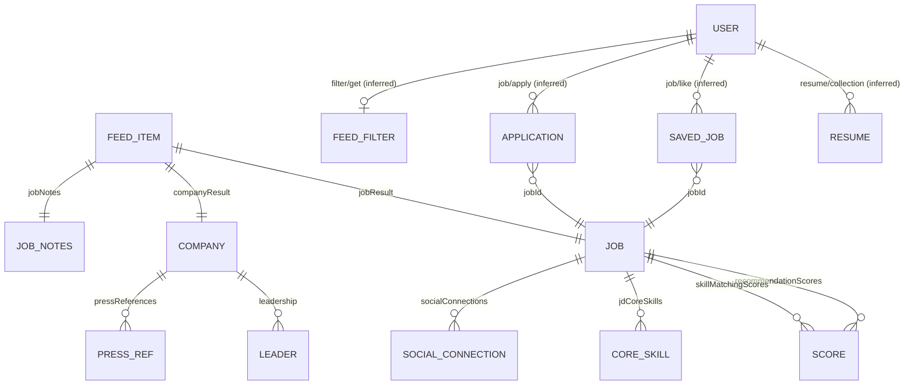

# 05: Data model (as seen in responses)

Field lists come from the value-free shapes in [shapes/](shapes/). "Seen in" names the capture and request. Entities that need a login were not observed on the wire. For those, only names from the bundle's endpoint paths are given, marked INFERRED.

## Feed item (wrapper). OBSERVED

Seen in `GET /swan/recommend/landing/jobs` (`s1`), SSR `/remote-jobs/*` (`p_remote`) and SSR `/jobs/info/[id]` (`s2`).

| Field | Type | Notes |
|---|---|---|
| `impId` | string | impression id, one per served item |
| `displayScore` | number | user match score, 0 when anonymous |
| `pos` | number | detail page only |
| `jobResult` | Job | |
| `companyResult` | Company | |
| `jobNotes` | `{boostedFactor: number, rankScore: number, notesMap: {string: string}}` | ranking debug data (see 04) |

## Job (`jobResult`). OBSERVED

| Group | Fields | List-only / detail-only |
|---|---|---|
| Identity | `jobId` (24-hex string, ObjectId-like), `url`, `applyLink`, `source` (number, e.g. 820/840), `sourceId`, `isDeleted`, `hiddenJob`, `repost`, `isToB` | `source, sourceId` on detail |
| Title | `jobTitle`, `jobNlpTitle` (normalized title), `jobSeniority` ("Mid, Senior Level"…), `firstTaxonomy`, `jobTaxonomyV3: string[3]` (domain > group > role) | taxonomy on detail |
| Place | `jobLocation`, `jobLocations[]`, `isRemote`, `workModel` (Onsite/Hybrid/Remote), `lat`, `lng`, `countryCode` | |
| Time | `publishTime` (`YYYY-MM-DD HH:mm:ss`, no offset; matches UTC), `publishTimeDesc` | |
| Pay and type | `salaryDesc`, `minSalary`, `maxSalary`, `employmentType` | min/max on detail |
| AI summaries | `jobSummary`, `jdResponsibilitySummary`, `coreResponsibilities[]`, `requirements[]` (list), `skillSummaries[]`, `educationSummaries[]`, `benefitsSummaries[]`, `whyJoinUs`, `qualifications{mustHave[], preferredHave[]}`, `detailQualifications{mustHave|preferredHave: {yoe[], education[], hardSkill[{skill}], softSkill[{skill}]}}`, `minYearsOfExperience` | most on detail |
| Skills and match | `jdCoreSkills[{skill, score, type}]`, `recommendationScores[{featureName, displayName, score}]`, `skillMatchingScores[…]`, `industryMatchingScores[…]` | detail |
| Labels | `recommendationTags[]`, `jobTags[]` ("Early applicant"), `h1BStatus`, `isH1bSponsor`, `isWorkAuthRequired`, `isCitizenOnly`, `isClearanceRequired` | |
| Social proof | `applicantsCount`, `jobRecruiter`, `jobRecruiterProfileUrl`, `socialConnections[{firstName, fullName, logoUrl, companyName, jobTitle, linkedinUrl}]` | detail. **Contains third-party personal data; values not recorded.** |
| Apply paths | `isCompanySiteLink`, `jobtargetEasyapply`, `jobtargetQuestionnaire`, `jobtargetJobId` | |
| Media | `jdLogo` | |

## Company (`companyResult`). OBSERVED

`companyId`, `mongoId` (list only, which points to MongoDB as a store; see 07), `companyName`, `companySize`, `companyDesc`, `gptShortDescription`, `companyCategories` (string), `companyGptCategories[]`, `companyRecommendationTags[]`, `companyURL`, `companyLogo`, `companyLinkedinURL`, `linkedinCompanyId`, `companyTwitterURL`, `companyCrunchbaseURL`, `companyFoundYear`, `companyLocation`, `fundraisingCurrentStage`, `fundraisingTotalFunding`, `fundraisingKeyInvestors[]`, `fundraisingLatestRounds[]`, `leadership[{pname, ptitle, plinkedinUrl, plogoUrl}]`, `pressReferences[{url, postedOn, title, publisher}]`, `h1bAnnualJobCount[]`, `h1bTitleDistribution[]`, `isAgency`, `isTnt`, `isForceJobLinkedinVerify`.

There is no separate company endpoint on the wire. The job detail's "company" content is this embedded object (`s2`). `companyResult` is denormalized onto every job. `notesMap.company_tier` (e.g. "funded") is a ranking-side company attribute.

## SEO list query (`pageProps.queryParams`). OBSERVED

`{slug[], domain, type, workModel: number[], seniority[], city, jobTitle (comma list)}` (`p_remote`).

## Session and user summary (`/swan/auth/newinfo`). OBSERVED, anonymous values only

`logined, userId, currentStage, email, memberInfo, resumeId, resumeName, linkedinResume, firstName, lastName, fullName, resumeErrMsg, linkedinProfileErrMsg, linkedinUrlVerified, companyIds, schoolIds, isNew, registerTime, registerFrom, clientTypes, linkedinUrl, enableAgent, showCoachLaunch, showCoachV2, country, config{tgOfferJobViewThreshold}, verified, topTalent`.

These fields mean the user record has an onboarding stage (`currentStage`), **one primary resume** (`resumeId, resumeName`), an optional LinkedIn profile used as the resume (`linkedinResume`, `linkedinUrl`, `linkedinUrlVerified`), membership (`memberInfo`), and target companies and schools (`companyIds, schoolIds`) (INFERRED from field names).

## A/B config (`/swan/ab/user`). OBSERVED

`{config: {flag: string}, exp: {flag: string}}`, with about 65 flags covering onboarding, pricing and offers, tailoring, autofill, Greenhouse easy-apply and search. Examples: `explore_ai_search`, `job_list_fetch_batch_size_20`, `new_pricing_exp_2606`.

## Entities that need a login (INFERRED from bundle endpoint names only)

| Entity | Evidence (path strings) | Likely relations |
|---|---|---|
| User profile | `/swan/profile/{get, save, edit, sync-resume, refresh-linkedin}`, `/swan/user-settings/{get,save}`, `/swan/candidate-preference`, `/swan/landing/{basic/pref, advanced/pref, career-goal, seeker-type}` | 1:1 user. Preferences feed the `e_*` search filters. |
| Resume | `/swan/resume/{upload, upload/status-v2, preview, download, name, collection/, collection/primary/set, collection/delete, export-style/*}`, `/swan/resume-tailor/*`, `/swan/resume-rewriter/*` | user 1:N resumes, one primary. Tailored versions per job (`resume-tailor` + `jobId`). Async parse (upload, then poll `status-v2`). |
| Saved job | `/swan/job/{like, unlike, like/count}`, `/swan/job/liked/jobs-v2` | user N:M job |
| Application / tracker row | `/swan/job/{apply, unapply, apply-status/save, apply/count}`, `/swan/job/applied/{jobs-v3, search-jobs}`, `/swan/import/{job, job-by-url, list, remove}` | user N:M job with a status. External jobs can be imported by URL into the tracker. |
| Feed filter | `/swan/filter/{get/filter, update/filter-v2, saved/list, saved/create, job-alert/*, digest/*}` | 1 active filter, N saved filters, alert and digest settings |
| Agent task | `/swan/agent/{task/list, task/save, task/new-batch, job/list, filter/confirm-v2, resume/tailor, cover-letter/*}` | auto-apply agent: tasks per job |
| Credits and membership | `/swan/credit/balance-v2`, `/swan/credit/free`, `/swan/payment/{subscription, price-v2, switch-plan, billing-portal}` | metered AI features plus a subscription |
