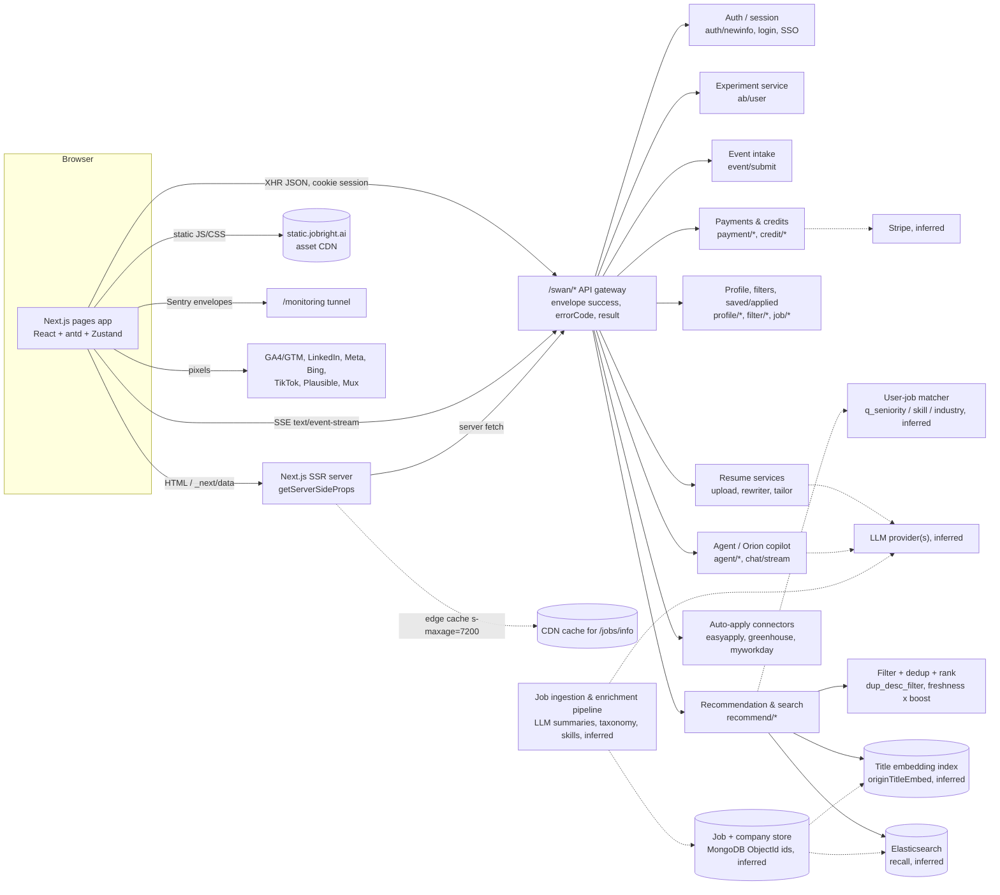

# 07: Backend design inferred from evidence

Each claim is tagged **OBSERVED** (seen directly in traffic or public files) or **INFERRED** (a reasoned reading of observed facts). Nothing here comes from private material.

## Architecture diagram

Solid lines are seen on the wire. Dotted lines and boxes marked "(inferred)" are reasoned from field names and counters.

## Services

| # | Claim | Tag | Evidence |
|---|---|---|---|
| 1 | One same-origin API prefix `/swan/*` returns a uniform envelope `{success, errorCode, errorMsg, result}` | OBSERVED | every `/swan/*` body in `s1`, `p_*` |
| 2 | `/swan` is a gateway or monolith in front of many domains (313 paths across about 45 first segments: recommend, filter, resume, resume-tailor, agent, payment, interview…) | INFERRED (path grouping; whether it is one process or many is not visible) | bundle path inventory (03 §B) |
| 3 | Next.js SSR fetches the same data server-side (SSR job lists use the same `jobResult` / `companyResult` / `jobNotes` shape as the XHR) | OBSERVED shape match. Server-to-server call INFERRED. | `p_remote` SSR vs `s1` XHR |
| 4 | Job detail HTML is edge-cached for 2 h with a 24 h stale-while-revalidate window. Other pages are uncached. | OBSERVED | `cache-control` headers in `s2`, `p_remote`, the landing `curl` |
| 5 | Session auth by cookie. User endpoints return 401 anonymously. | OBSERVED | `p_feed` 401s, `withCredentials` |
| 6 | A server-side experiment service assigns about 65 flags per visitor | OBSERVED | `GET /swan/ab/user` (`s1`) |
| 7 | First-party event intake for impression and exposure events | OBSERVED | `POST /swan/event/submit`, `eventType` list (03) |
| 8 | Sentry is proxied through a first-party tunnel | OBSERVED | `POST /monitoring?o&p` |

## Search and recommendation

| # | Claim | Tag | Evidence |
|---|---|---|---|
| 9 | Multi-retriever recall: lexical title retrieval (`titleText`, cap 3000) plus title-embedding retrieval (`originTitleEmbed`, cap 500), merged to the unique set (3192) | OBSERVED (counters). "Embedding" is INFERRED from the key name. | `notesMap` in `p_remote` |
| 10 | Lexical recall runs on **Elasticsearch** with a deadline | INFERRED | `notesMap.es_recall_deadline_nanos` |
| 11 | Taxonomy-based retrieval for the landing feed (`titleTaxonomy`, `taxonomy_ids` like `01-08-02`). Jobs carry a 3-level taxonomy (`jobTaxonomyV3`). | OBSERVED | `s1` landing `notesMap`. `s2` detail. |
| 12 | A filter chain with per-filter counters (salary, h1b, skill, staffing-agency, clearance, years-of-experience, company category or stage, …) | OBSERVED | `notesMap` `*_filter` keys |
| 13 | Dedup by job-description similarity before ranking (821 of 3192 removed) | OBSERVED counter. Method INFERRED. | `dup_desc_filter` |
| 14 | Ranking is multiplicative: `rankScore = freshness × mix_rank × title_boost × company_scatter_demote` | OBSERVED (80 of 80) | 04 §4 |
| 15 | Freshness decays linearly (visitor search: −0.0075/h from 1.18; landing: about −0.0036/min in the first hour, then hourly buckets) | OBSERVED fit | 04 §4 |
| 16 | Strategy versions and ranking A/B buckets are set per request | OBSERVED | `recommend_recall v4`, `ranking_test_1 v2`, … |
| 17 | The personal match score is computed per user against the resume or profile (zero for anonymous). Job-side skill weights are precomputed. | INFERRED | 04 §6 |
| 18 | The logged-in feed is a server-held ranked list that is paged by offset and can be re-ranked (`refresh`, `syncRerank`) | INFERRED | `list/jobs` params |

## Data and storage

| # | Claim | Tag | Evidence |
|---|---|---|---|
| 19 | Job ids and `mongoId` are 24-hex ObjectIds, which points to **MongoDB** as a primary store | INFERRED | `jobId` format, `companyResult.mongoId` |
| 20 | Jobs are aggregated from external sources, including LinkedIn (`linkedin_job_id` on each job), with `source` codes (820, 840) and JobTarget, Lensa, Greenhouse and Workday integrations | OBSERVED fields and paths. Sourcing method INFERRED. | `notesMap.linkedin_job_id`, `jobResult.source`, bundle paths |
| 21 | Company enrichment combines LinkedIn, Crunchbase-style funding data, press, leadership and H1B history, plus LLM-written fields (`gptShortDescription`, `companyGptCategories`) | OBSERVED fields. Provider INFERRED. | `companyResult` in `s2` |
| 22 | An **LLM enrichment pipeline** writes job summaries, responsibilities, qualification breakdowns and skill lists offline (all present for anonymous users at SSR time) | INFERRED | `jobSummary`, `detailQualifications`, `jdCoreSkills` in `s2` |
| 23 | Resume upload is asynchronous (upload, then poll `status-v2`, with `cancel`). Parsing happens in a background job or queue. | INFERRED | bundle paths `/swan/resume/upload`, `/upload/status-v2`, `/upload/cancel`, `/upload-session` |
| 24 | Long AI tasks follow a start/status/result pattern (`resume-rewriter/diagnose/{start, status, result, cancel, global-status}`, `import/job-by-url/status`, `agent/task/new-batch`), which points to queues or workers | INFERRED | bundle paths |

## AI features

| # | Claim | Tag | Evidence |
|---|---|---|---|
| 25 | Chat copilot ("Orion") streams over SSE and is rate-limited (429) | OBSERVED (client code) | chunks `15902-*`, `97342-*` |
| 26 | AI features: resume tailor (diff, keywords, expect-score, chat), rewriter and diagnose, cover letter, AI search (`/swan/aisearch`), interview coding runner (`/swan/interview/coding/run`), voice chat (`voice-chat/runtime-config`) | OBSERVED paths. Behavior INFERRED. | bundle |
| 27 | An auto-apply agent submits to ATSs (`easyapply/submit` with `provider: greenhouse`, `myworkday/tasks`) | OBSERVED paths and fields | `_app` interceptor, bundle |
| 28 | Metered credits gate the AI features, alongside a subscription ("Turbo" in the flag names), with Stripe checkout | OBSERVED paths and flags. Stripe use INFERRED from the SDK in chunks plus `/api/checkout_sessions`. | `/swan/credit/balance-v2`, `ab/user` flags, bundle |
| 29 | Which LLM vendor is used | not determinable | the only "openai" hit is a press badge (chunk `37683-*`) |
